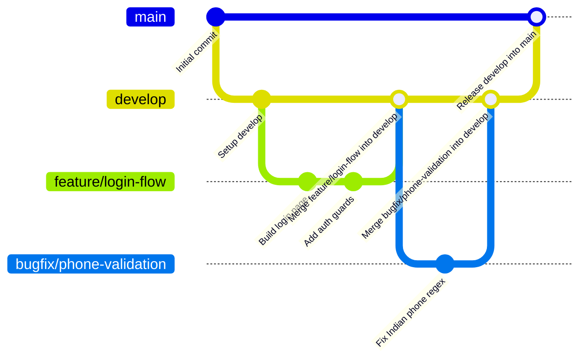

# AI Agents & Developer Workflow Guide

This document establishes the mandatory development workflows, branching strategies, and operational policies for all AI agents and human contributors working on this CRM codebase.

---

## 1. Git Branching Strategy & Nomenclature

We strictly follow a structured GitFlow-based branching strategy:

| Branch Type | Naming Convention | Base / Branched From | Merge Target | Purpose |
| :--- | :--- | :--- | :--- | :--- |
| **Main** | `main` | Repository Initial | *None (Protected)* | Production-ready stable release code. |
| **Develop** | `develop` | `main` | `main` | Primary active development and integration branch. |
| **Feature** | `feature/<feature-name>` | `develop` *(or `main` in special cases)* | **`develop` ONLY** | New features, enhancements, or UI additions. |
| **Bugfix** | `bugfix/<bug-name>` | `develop` or feature branch | **`develop` ONLY** | Bug fixes found in `develop` or ongoing feature branches. |
| **Hotfix** | `hotfix/<fix-name>` | `main` | `develop` | Critical emergency fixes for issues discovered in `main`. |

---

## 2. Cardinal Rules (Non-Negotiable)

1. **NEVER CODE DIRECTLY ON `main`:**
   - Direct commits to `main` are strictly forbidden.
   - All work happens in dedicated `feature/` or `bugfix/` branches, or through `develop`.

2. **NEVER MERGE FEATURE OR BUGFIX BRANCHES DIRECTLY INTO `main`:**
   - `feature/*` and `bugfix/*` branches must **only** be merged into `develop`.

3. **ONLY `develop` MERGES INTO `main`:**
   - `main` only receives merges from `develop` when a version or milestone is fully verified, tested, and ready for production.

4. **HOTFIX PROTOCOL:**
   - Bugs discovered in `main` are branched as `hotfix/<fix-name>`.
   - Once fixed and verified, they are merged into `develop`, and then `develop` merges into `main`.

5. **BRANCH NAMING CONVENTION:**
   - Features: `feature/lead-timeline-sync`, `feature/export-excel-custom-fields`, etc.
   - Bug fixes: `bugfix/fix-meta-webhook-timeout`, `bugfix/ist-date-offset-correction`, etc.
   - Hotfixes: `hotfix/auth-session-recovery-fix`, etc.
   - All lowercase, hyphen-separated.

---

## 3. Standard Git Workflow Lifecycle



### Step-by-Step Command Guide:

#### Starting a New Feature:
```bash
git checkout develop
git pull origin develop
git checkout -b feature/<feature-name>
```

#### Finishing a Feature:
```bash
git add .
git commit -m "feat: implement <feature-name>"
git checkout develop
git pull origin develop
git merge feature/<feature-name>
# Push develop
git push origin develop
```

#### Fixing a Bug found in Develop:
```bash
git checkout develop
git checkout -b bugfix/<bug-name>
# Implement fix
git commit -m "fix: resolve <bug-name>"
git checkout develop
git merge bugfix/<bug-name>
```

#### Hotfix for a Bug found in Main:
```bash
git checkout main
git checkout -b hotfix/<fix-name>
# Implement critical fix
git commit -m "hotfix: resolve <fix-name>"
git checkout develop
git merge hotfix/<fix-name>
git checkout main
git merge develop
```

---

## 4. Requirements & Documentation Alignment
- Any new requirement requested by the user must be logged into [requirement/PROJECT_REQUIREMENTS.md](file:///Users/surojuhomsaisantosh/Documents/PROJECTS/UNIVERSAL%20CRM%20/requirement/PROJECT_REQUIREMENTS.md).
- Any database schema changes must be documented and updated in [requirement/supabase_schema.sql](file:///Users/surojuhomsaisantosh/Documents/PROJECTS/UNIVERSAL%20CRM%20/requirement/supabase_schema.sql).
