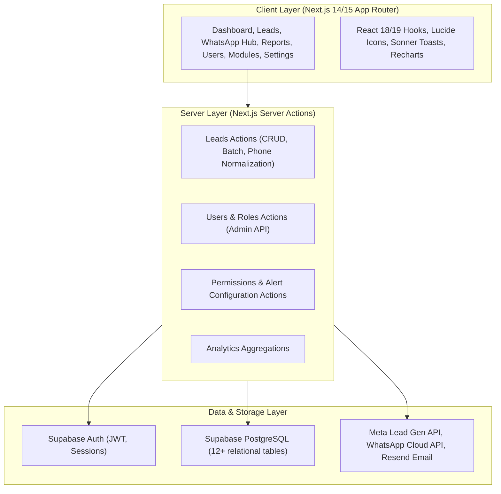

# Universal CRM — In-Depth Architecture & System Analysis

## 1. Executive Summary

This CRM software was originally engineered as an enterprise-grade operational back-office for real estate / multi-channel lead acquisition. It features **lead ingestion, automated phone synchronization, WhatsApp chatbot activity timelines, multi-format exports (PDF/Excel/CSV), dynamic pipeline status managers, and role/user permission matrices**.

The codebase currently pasted under `CRM/(CRM_SOFTWARE)/crm` represents the **Next.js App Router sub-tree** (`app/crm/*`), along with its client-side React components and Next.js Server Actions.

---

## 2. Technology Stack & Architectural Patterns

### Core Technologies:
1. **Frontend:** Next.js (App Router), TypeScript, Tailwind CSS.
2. **Icons & UI:** Lucide React, Sonner (toast notifications), Recharts (data visualizations).
3. **Backend:** Next.js Server Actions (`'use server'`).
4. **Database & Auth:** Supabase (PostgreSQL with Row Level Security + Supabase Auth).
5. **Integrations Identified in Code:**
   - **Resend:** For sending user credential invites, password resets, and automated daily email digests.
   - **Meta Lead Ads:** Form webhook ingestion and automatic lead syncing.
   - **WhatsApp Cloud API:** Chat activity logging, automated WhatsApp daily digest reports.
   - **Sanity CMS:** Originally queried in `projects/page.tsx` for real estate project brochures (can be transitioned to native Supabase `projects` table for a standalone CRM).

---

## 3. Comprehensive Module Breakdown

### 3.1. Dashboard Overview (`/crm`)
- **File:** `CRM/(CRM_SOFTWARE)/crm/page.tsx`
- **Functionality:**
  - Real-time KPI statistics cards: Total Leads, Today's Leads, New, Uncontacted, Contacted, Qualified, Rejected, Closed.
  - Interactive drill-down: Clicking any status card loads a paginated table of matching leads below the KPI cards without reloading the page.
  - Quick pagination (50 items per page).

### 3.2. Leads Pipeline (`/crm/leads`)
- **Files:** `page.tsx`, `LeadsClient.tsx`, `actions.ts`, `components/ExportLeadsModal.tsx`
- **Functionality:**
  - **Dynamic Status Pills:** Fetches pipeline stages dynamically from the database (`lead_statuses`).
  - **Smart Phone Synchronization:** When updating a lead's status, the action normalizes the phone number (via `canonicalPhoneNumber`) and can automatically cascade the status change across duplicate inquiries submitted by the same phone number.
  - **IST Date Filtering:** Timezone-anchored filtering (`Asia/Kolkata +05:30`) to prevent UTC day-shift bugs on cloud servers (e.g. Vercel).
  - **Multi-Format Export Modal:** Configurable column selection supporting PDF, Excel (.xlsx), and CSV exports.
  - **Meta Lead Form Management:** Track and sync Facebook/Instagram lead forms with automated 15-minute polling support.
  - **Batch Operations:** Multi-select leads for bulk status updates or bulk deletion.

### 3.3. WhatsApp Leads Hub (`/crm/whatsapp`)
- **Files:** `page.tsx`, `WhatsappDashboardClient.tsx`, `actions.ts`
- **Functionality:**
  - Filtered view of leads originating from WhatsApp chat campaigns.
  - Joins the `lead_activities` table to render chronological conversation and event timelines (e.g., "Requested Callback", chat timestamps).
  - WhatsApp engagement metrics: Total interactions, callback requests, and conversion analytics.

### 3.4. Projects & Inventory Catalog (`/crm/projects`)
- **Files:** `page.tsx`, `ProjectsClient.tsx`
- **Functionality:**
  - Card-based showcase of properties/projects with downloadable brochures, layout plans, and legal/government approval certificates (RERA, DTCP).
  - *Note:* Originally fetched via Sanity CMS (`client.fetch(PROJECTS_QUERY)`). In a standalone Universal CRM, this should be backed directly by the `projects` table in Supabase so the new company does not need an external Sanity CMS account unless desired.

### 3.5. Reports & Analytics (`/crm/reports`)
- **Files:** `page.tsx`, `ReportsClient.tsx`
- **Functionality:**
  - Conversion funnel and status distribution using **Recharts** (Bar charts, Pie charts).
  - Lead acquisition channel breakdown (Website, WhatsApp, Meta Ads, Direct).
  - Time-range analysis (Today, 7 days, 30 days, Custom).

### 3.6. Feature Controls & Dynamic Modules (`/crm/modules`)
- **Files:** `page.tsx`, `ModulesClient.tsx`, `actions.ts`, subcomponents:
  - `AccessControl.tsx`: Role and User-level granular permission matrix (`view`, `edit`, `none`) across all 8 modules.
  - `LeadStatusManager.tsx`: Dynamic pipeline builder — allows administrators to create, reorder, edit, and color-code pipeline stages (with predefined color palettes).
  - `AutomatedReportsEmail.tsx`: Schedule daily email digests with specific cron slots (e.g., 09:00, 18:00).
  - `WhatsAppReports.tsx`: Schedule automated WhatsApp report summaries to management phone numbers.
  - `Alerts.tsx`: Subsystem health monitor (Supabase latency, Resend status, Meta token validity) with automated alerting to emergency contacts.
  - `WebsiteDownloadsOtp.tsx`: Toggle OTP requirements for lead magnet downloads.

### 3.7. User & Role Administration (`/crm/users`)
- **Files:** `page.tsx`, `UsersClient.tsx`, `actions.ts`
- **Functionality:**
  - User creation via Supabase Admin API (`supabaseAdmin.auth.admin.createUser`).
  - Automatic dispatch of password-setup invite links via email (or password reset).
  - Role assignment (Super Admin, Admin, Telecaller, or custom roles).
  - Safe role deletion with user reassignment to a fallback role.
  - Disabling and enabling user access.

### 3.8. Account Settings (`/crm/settings`)
- **Files:** `page.tsx`, `SettingsClient.tsx`
- **Functionality:**
  - In-app password change for currently authenticated staff members.

---

## 4. Gap Analysis: What is Missing to Run the Software

Currently, only the `CRM/(CRM_SOFTWARE)/crm` route files are present in the folder. To execute `npm run dev` and open the app in a browser, the following pieces are required:

| Component | Current Status | What Needs to be Created |
| :--- | :--- | :--- |
| **Root Next.js App** | Missing | `package.json`, `tsconfig.json`, `next.config.mjs`, `tailwind.config.ts`, `postcss.config.js` |
| **Root Layout & CSS** | Missing | `app/layout.tsx`, `app/globals.css` with font and Tailwind setup |
| **Login Page** | Missing | `app/crm/login/page.tsx` with email/password form and session handling |
| **Navigation Sidebar** | Missing | `@/components/dashboard/Sidebar.tsx` referenced in `crm/layout.tsx` |
| **Supabase Client/Server** | Missing | `@/lib/supabase/client.ts` & `@/lib/supabase/server.ts` |
| **Permissions Guard** | Missing | `@/lib/auth/permissions.ts` implementing `requireAccess(moduleName)` |
| **Helper Utilities** | Missing | `@/lib/phone-input.ts` (canonical phone, validation) `@/lib/reports/leads-export.ts` (PDF/Excel generator) `@/lib/otp-config.ts` `@/lib/monitoring/alerts.ts` |
| **Environment Config** | Missing | `.env.local` template with Supabase URL & keys |
| **Database Schema** | **Ready** | `requirement/supabase_schema.sql` (generated) |

---

## 5. Company White-labeling Roadmap

To use this CRM for another company, the following specific references need to be cleaned up:
1. **Brand Names:**
   - Change `BhuwantaCRM` / `Bhuwanta` in `crm/layout.tsx`, `Alerts.tsx`, `unauthorized/page.tsx` to a dynamic company name or configuration variable (`NEXT_PUBLIC_COMPANY_NAME`).
2. **Hardcoded Master Email:**
   - In `crm/modules/actions.ts` (lines 96, 1278, 1435), `bhuwanta9@gmail.com` is hardcoded as the default master alert email. This should be made configurable via environment variable (`MASTER_ADMIN_EMAIL`).
3. **Domain References:**
   - In `crm/users/actions.ts` (line 68), default URL fallback is `https://bhuwanta.com`. This should use `NEXT_PUBLIC_BASE_URL` or `localhost:3000`.
4. **Sender Email / Resend Domain:**
   - Update from `bhuwanta.com` to the new company's domain.

---

## 6. Execution Plan to Run the CRM

Once approved, the implementation will proceed through the following clean steps without breaking existing code:

1. **Step 1 — Foundation Setup:**
   - Create root `package.json` with all dependencies (`next`, `react`, `react-dom`, `@supabase/supabase-js`, `@supabase/ssr`, `lucide-react`, `sonner`, `recharts`, `xlsx`, `jspdf`, `tailwind`, etc.).
   - Configure Tailwind CSS, PostCSS, and TypeScript.
   - Install dependencies.

2. **Step 2 — Core Infrastructure & Libraries:**
   - Scaffold `@/lib/supabase/client.ts` and `@/lib/supabase/server.ts`.
   - Implement `@/lib/auth/permissions.ts` and `@/lib/phone-input.ts`.
   - Build the responsive `@/components/dashboard/Sidebar.tsx`.
   - Implement `@/lib/reports/leads-export.ts`.

3. **Step 3 — Login & Authentication Flow:**
   - Build clean modern Login page at `/crm/login`.
   - Set up middleware to redirect unauthenticated requests to `/crm/login`.

4. **Step 4 — Database Migration:**
   - Execute `requirement/supabase_schema.sql` on the user's Supabase project.
   - Connect `.env.local` with the user's Supabase project credentials.

5. **Step 5 — Run & Verify:**
   - Start local development server with `npm run dev`.
   - Verify all routes (`/crm`, `/crm/leads`, `/crm/whatsapp`, `/crm/reports`, `/crm/modules`, `/crm/users`, `/crm/settings`, `/crm/login`).
